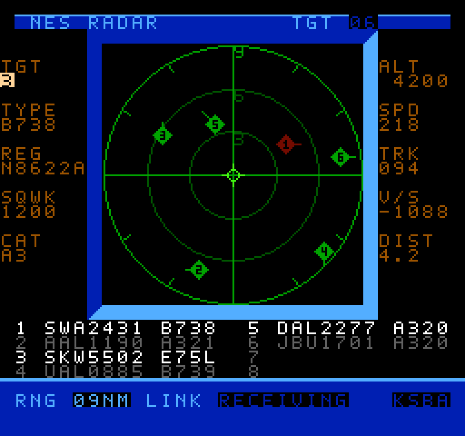
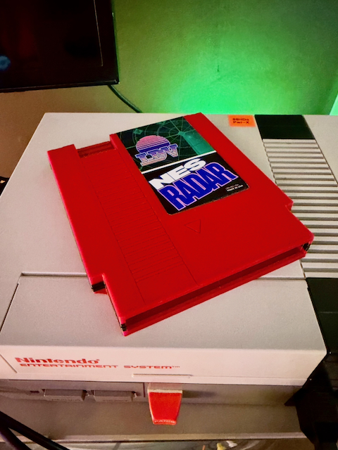

# NES Radar

**NES Radar turns a real Nintendo Entertainment System into a live air traffic scope.**

**This project is in active development. Check back soon for updates and improvements.**

Type any airport's four-letter ICAO code on the NES controller, press Start, and the aircraft actually flying near that airport *right now* appear as moving targets on your TV.

It works for airports worldwide. Point it at your local field and watch the approach traffic line up, or at KLAX and watch it get busy. Watch this [video demo](https://youtu.be/hZ8sniz4Z2M?si=-s4Dm2YlZwRVx9xd).

The NES can't reach the Internet, so a [nesp32](https://github.com/Armitage64/nesp32) on controller port 2 does it instead: it fetches live traffic from [adsb.fi](https://adsb.fi) over Wi-Fi and hands it to the ROM. The nesp32 looks up where each airport is on [Wikidata](https://www.wikidata.org).

This project is based on [c64u-radar](https://github.com/k6lcm/c64u-radar), a similar program for the Commodore 64.

> [!NOTE]
> **Still using the FTDI cable?** From 0.5.0 NES Radar needs a nesp32. The cable, the computer-side server and the 0.4.4 ROM are on the [`legacy/ftdi-0.4.x`](https://github.com/k6lcm/nes-radar/tree/legacy/ftdi-0.4.x) branch and the [0.4.4 release](https://github.com/k6lcm/nes-radar/releases/tag/0.4.4).

---

*The data blocks show TGT: Target #, TYPE: Aircraft Type, REG: Registration, SQWK: Squawk Code, CAT: Category, ALT: Altitude, SPD: Speed (kts), TRK: Track (degrees), V/S: Vertical Speed (ft/min), DIST: Distance From Airport/Center*

## What you need

- A real NES and a flash cartridge to load the ROM
- A [nesp32](https://github.com/Armitage64/nesp32) on controller port 2, with its firmware flashed and put on Wi-Fi by its Setup program
- A normal controller in port 1, to enter the airport code
- A Wi-Fi network with Internet access

The ROM is also on the nesp32's own cartridge, from its menu.

Downloads live on the [Releases page](https://github.com/k6lcm/nes-radar/releases).

## Using it

1. Load the ROM on the NES with the nesp32 in port 2.
2. Up and Down change a letter, Left and Right move along the four. The editor starts at the last airport the nesp32 found, which it keeps when switched off, or KSBA if there is none.
3. Press Start or A.

On the scope the direction buttons choose among the aircraft, and B goes back to the editor. On the nesp32's cartridge, Select goes back to its menu, from the editor or the scope.

| The editor says | Meaning |
|---|---|
| `REQUESTING` | the nesp32 is looking the airport up: a second or two |
| `INVALID AIRPORT` | Wikidata knows no airport with that ICAO code |
| `LOOKUP FAILED` | Wikidata did not answer. Press Start or A to try again |
| `NO NESP32 ANSWER` | no nesp32 is connected, or it is running something else |
| `NESP32 NO WI-FI` | the nesp32 has not been set up, or the network is out of reach |
| `UPDATE NESP32` | its firmware is older than this ROM, and has no RADAR service |

| The scope's `LINK` says | Meaning |
|---|---|
| `LIVE` | the nesp32 answers, and the scene on the screen is good |
| `LIVE...` | new data is coming in: a scene, or its aircraft's names. The dots go one, two, three, for half a second |
| `WAITING` | no aircraft yet, or none for ten seconds, or nothing from adsb.fi for thirty |
| `NO ANSWER` | the nesp32 has stopped answering. The last scene stays |
| `BAD DATA` | the nesp32 sent an aircraft or a name that cannot be shown |
| `ADSB DOWN` | the nesp32's last fetch from adsb.fi failed. The last scene stays |

The nesp32 fetches the aircraft every eight seconds, so `LIVE...` comes
round about that often.

Wikidata has most airports, but not every small field, and it puts some a little way from where other databases have them.

## Limits

- The scope covers **9 nautical miles** and shows at most **eight aircraft**. More than four markers sharing scanlines use deliberate NES sprite-priority flicker.
- Live traffic needs the nesp32 to reach adsb.fi and Wikidata over HTTPS.
- PAL consoles are not claimed.

## Making changes

NES Radar is in two repositories: the ROM is here, and
[nesp32](https://github.com/Armitage64/nesp32) has this repository as a
submodule, builds it for its cartridge, and has the firmware it talks to.
ROM changes are made here and released, and nesp32 then moves its
submodule to them. [`AGENTS.md`](AGENTS.md) has which change goes where
and the rules for keeping the two in step.

## Repository layout

| Path | What it is |
|---|---|
| [`CHANGELOG.md`](CHANGELOG.md) | Version-by-version summary. |
| [`AGENTS.md`](AGENTS.md) | How changes are made here and in nesp32 (`CLAUDE.md` points to it). |
| [`nes_radar/`](nes_radar) | The buildable NES ROM source, build files, record documentation, and required runtime assets. |
| `nes_radar/vendor/nesp32/` | A copy of the nesp32's link library for the console. |

Prior releases are tagged in git and their downloads are attached to their own [Release entries](https://github.com/k6lcm/nes-radar/releases). [`0.4.4`](https://github.com/k6lcm/nes-radar/tree/0.4.4) is the last FTDI-cable ROM and server, maintained on [`legacy/ftdi-0.4.x`](https://github.com/k6lcm/nes-radar/tree/legacy/ftdi-0.4.x). [`0.3.1`](https://github.com/k6lcm/nes-radar/tree/0.3.1) is the pulse-width cable and ROM.

